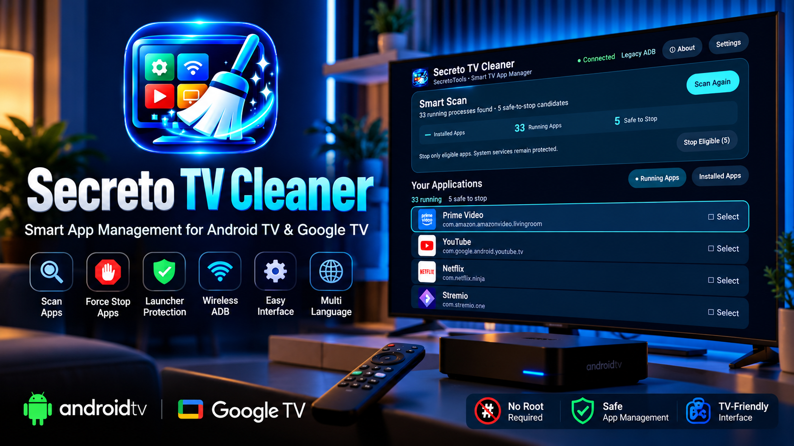
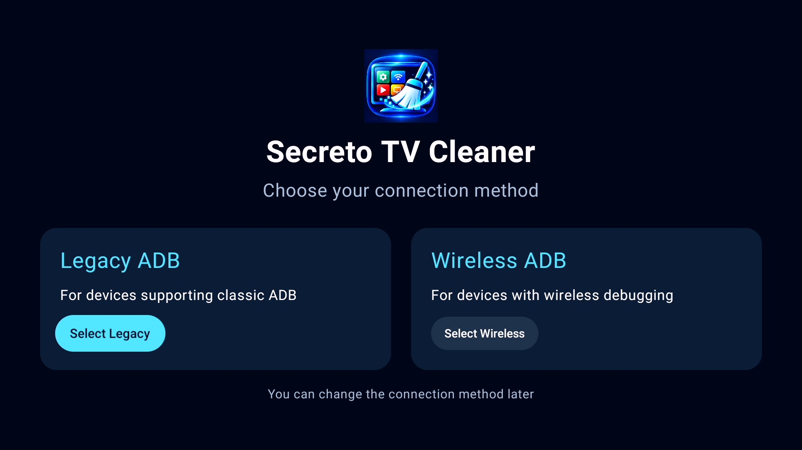
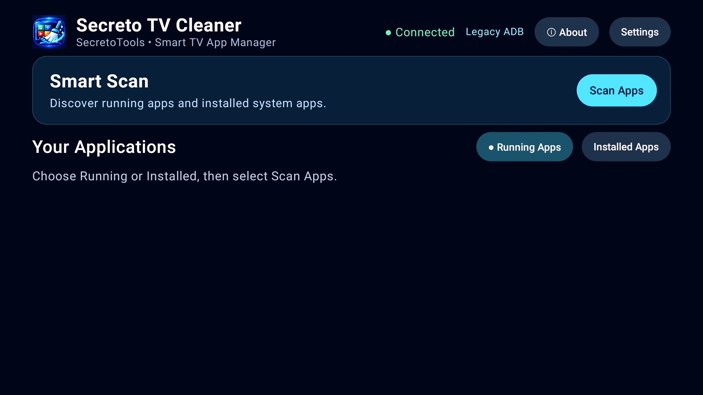
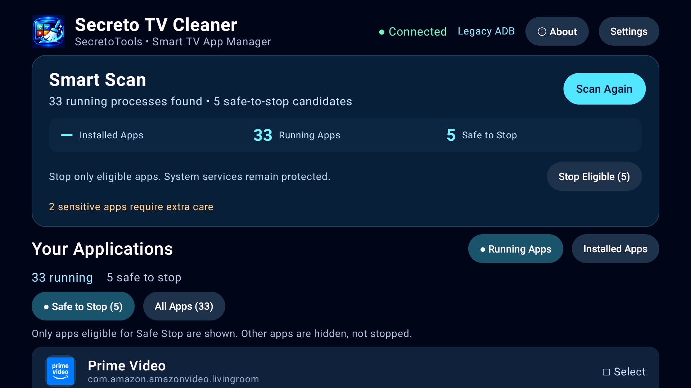
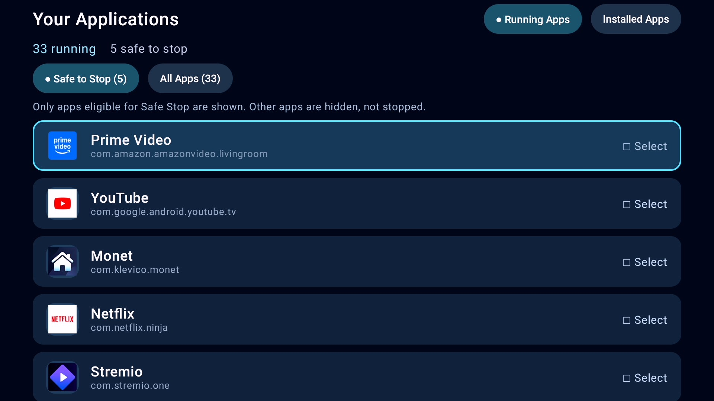
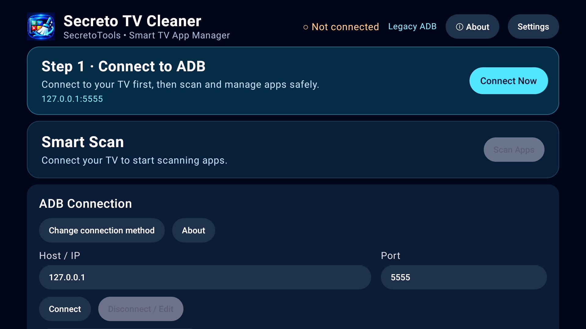

# Secreto TV Cleaner — سيكريتو تي في كلينر

**إدارة تطبيقات Android TV وGoogle TV باستخدام ADB دون الحاجة إلى الروت**

 

**اللغات:** [English](README.md) · [Français](README.fr.md) · العربية

تطوير **محمد لالاح / SecretoTools** · قناة [SecretofNet](https://www.youtube.com/@SecretofNet)

## نبذة عن التطبيق

يساعدك Secreto TV Cleaner على فحص التطبيقات عبر اتصال ADB تُجيزه بنفسك وإيقاف التطبيقات المؤهلة على أجهزة Android TV وGoogle TV. وهو **أداة لإدارة التطبيقات**، وليس مضاداً للفيروسات أو برنامجاً يضمن تسريع الجهاز.

### صور من التطبيق

الصور التالية من واجهة التطبيق الحقيقية، وتُعرض بأحجام مصغّرة لتسهيل تصفح الصفحة.

   
   
   
   
   

## المميزات

- الاختيار بين اتصال ADB التقليدي والتصحيح اللاسلكي على الأجهزة الداعمة.
- فحص العمليات قيد التشغيل وعرض التطبيقات المثبتة.
- تمييز التطبيقات المؤهلة للإيقاف والتنبيه إلى التطبيقات الحساسة مع حماية خدمات النظام الأساسية.
- إيقاف تطبيق محدد أو مجموعة من التطبيقات المؤهلة.
- واجهة مناسبة للريموت، بثلاث لغات: العربية والإنجليزية والفرنسية.
- لا يحتاج إلى صلاحيات الروت.

## التحميل والاستعمال

1. حمّل ملف APK الموقّع من [صفحة الإصدارات](https://github.com/mohamedlalah/SecretoTVCleaner/releases) بعد نشر الإصدار.
2. ثبّته على جهاز Android TV أو Google TV تملكه أو لديك إذن بإدارته.
3. اتبع تعليمات التطبيق لتفعيل اتصال ADB والسماح به.
4. افحص التطبيقات وراجع النتائج قبل إيقاف أي تطبيق.

**اسم الحزمة:** `com.secreto.tvcleaner` · **الإصدار:** `1.0.0` · **الحجم:** نحو 20 ميغابايت

**APK SHA-256:** `8865fcf64602254be24ce0606a3b1ef235991562830843aa162d7feaac5589d2`

**Signing certificate SHA-256:** `c091efe74da9599a4e465260d4d6a910faef3c07fe94dddf0094296dc2eda31e`

## تنبيهات الأمان والتوافق

- فعّل ADB فقط على الأجهزة المملوكة لك أو التي لديك إذن بإدارتها، ويفضل استعمال شبكة محلية موثوقة. أوقف التصحيح عند الانتهاء.
- قد يؤدي الإيقاف الإجباري إلى قطع تشغيل الفيديو أو المهام الخلفية، وقد يعيد Android تشغيل التطبيقات لاحقاً.
- تساعد فلاتر الحماية على تقليل المخاطر، لكنها لا تضمن خلو كل عملية إيقاف من التأثيرات الجانبية.
- تختلف النتائج حسب الشركة المصنّعة وإصدار النظام وصلاحيات ADB.
- لا يضمن التطبيق حذف الكاش أو تحرير الذاكرة أو كشف البرمجيات الخبيثة أو تحسين سرعة الجهاز.

## ❤️ دعم المشروع

التطبيق متاح للتحميل مجاناً. إذا استفدت منه وترغب في المساهمة في استمرار التطوير والاختبارات وإنتاج أدوات جديدة، يمكنك [دعم محمد لالاح عبر GitHub Sponsors](https://github.com/sponsors/mohamedlalah). **الدعم اختياري وليس شرطاً لاستعمال التطبيق.**

## حقوق النشر والتوزيع

© 2026 محمد لالاح / SecretoTools. جميع الحقوق محفوظة. يحتوي هذا المستودع على التوثيق وملفات التوزيع فقط، **ولا يتضمن الكود المصدري للتطبيق**. التطبيق ليس مفتوح المصدر. تم تسجيل اسم الحزمة وشهادة توقيع التطبيق في برنامج التحقق من مطوري Android لدى Google؛ وهذا لا يعني نشر التطبيق على Google Play أو حصوله على تزكية من Google.

[SecretoTools](https://secretotools.com) · [SecretofNet](https://www.youtube.com/@SecretofNet) · [GitHub Sponsors](https://github.com/sponsors/mohamedlalah)
